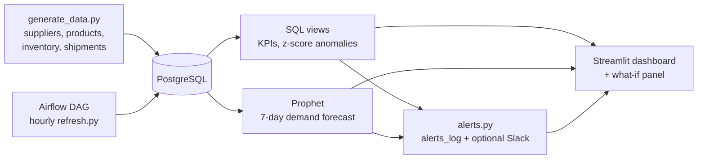

# DA-03: Retail and Supply Chain Control Tower

A near real-time view of inventory, deliveries and suppliers that warns about problems before they hurt sales.

**Note:** All data is synthetic, generated with `generate_data.py`, so the numbers show the pipeline working and are not real business findings. Apache Superset was replaced with Streamlit to keep setup light and fast.

## Architecture



## What it does

- **Data:** PostgreSQL with suppliers, products, hourly inventory and shipments
- **Hourly refresh:** Airflow DAG `supply_chain_hourly_refresh` runs `refresh.py` every hour and adds new inventory rows
- **KPIs (SQL views):** stock-out rate, on-time delivery, supplier lead time, days of inventory
- **Anomaly detection:** z-score on daily demand per product and on supplier delivery delays
- **Forecast:** Prophet predicts 7-day demand for 15 products and compares it with current stock (`demand_forecast` table)
- **Alerts:** `alerts.py` writes stock-out risks, demand spikes and supplier delays to `alerts_log`. It also posts to Slack if `SLACK_WEBHOOK_URL` is set (not configured in this demo)
- **Dashboard:** Streamlit app with KPI cards, charts, forecast table and a what-if panel (pick a supplier, add extra delay days, see which products run out)

## Sample results (synthetic data)

- 20 alerts generated in one run: 13 stock-out risks, 2 demand spikes, 5 supplier delays
- Demand spike detected on product 14 (z-score 7.79)
- What-if: an 8-day delay on one supplier puts 3 of 3 of its products at risk

## Tech stack

PostgreSQL, Airflow, Docker, Python, Prophet, Streamlit, SQL

## How to run

Needs Docker (I used GitHub Codespaces).

```bash
cd DA-03
docker compose up -d          # Postgres + Airflow
pip install psycopg2-binary numpy pandas sqlalchemy prophet streamlit
python generate_data.py       # create tables and data
docker exec -i supply_pg psql -U supply -d supplychain < sql/kpis.sql
docker exec -i supply_pg psql -U supply -d supplychain < sql/anomalies.sql
python forecast.py
python alerts.py
streamlit run dashboard.py
```

Airflow UI is on port 8080. Unpause the DAG `supply_chain_hourly_refresh`.

## Status

- [x] PostgreSQL and data generator
- [x] Airflow hourly refresh DAG
- [x] KPIs
- [x] Anomaly detection
- [x] Forecasting
- [x] Dashboard with what-if panel
- [x] Alerts
- [ ] Demo video

## Author

Jessica Katru